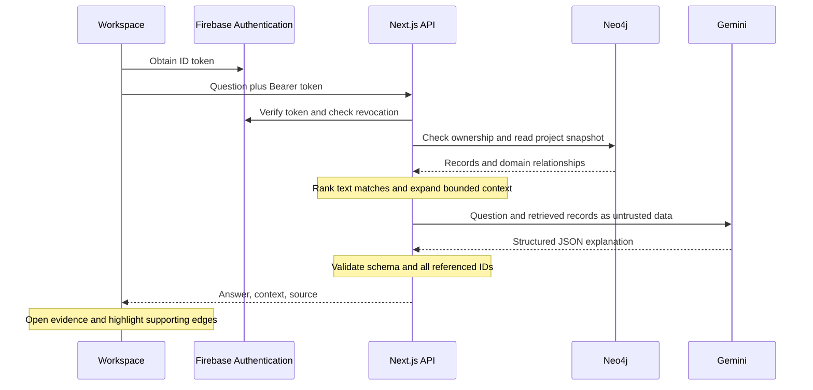

# Architecture and retrieval

TraceReason is one Next.js application. Firebase identifies users, Neo4j persists authenticated project memory, and Gemini explains retrieved context. React Flow renders graph records and relationships in the browser. There is no Firestore store, embedding service, separate vector database, or model-controlled query executor.

## Request flow

## Retrieval steps

1. Verify the Firebase token with revocation checking. Derive the UID from that token.
2. Load only the owned project's snapshot through the Neo4j repository. Reject snapshots beyond the MVP record or relationship limits.
3. Filter records and relationships by the selected `projectId` again in TypeScript. Ignore edges whose endpoints are absent from that project.
4. Tokenize the question into distinct lowercase alphanumeric words. Remove short words and common stop words. Score substring matches in fields, with additional weight for matches in the record label. Break equal scores by stable record ID.
5. Start from up to six matching records and expand at most three rounds over incident edges. Traversal considers both directions for discovery while retaining the stored edge direction in the result.
6. Keep at most 24 records and 40 edges. Divide an 850-character field budget across each record's fields, then trim the serialized context to at most 32,000 UTF-8 bytes. Report truncation through the context flag.
7. Send only this retrieved context and the question to Gemini. Request structured JSON with a 60-second total deadline and a 4,000-token output limit. Gemini 3 model names use low thinking; the configured model remains explicit.
8. Parse JSON, validate with Zod, and check every record, evidence, and supporting-edge citation against the retained context. Each documented fact must cite a retrieved record or evidence item. Reject invalid output rather than showing an invented answer.

This is deterministic text retrieval followed by graph expansion in application code. It is not vector search, a Neo4j full-text search, or a variable-length Cypher traversal. There is no model-generated Cypher.

Citation checks validate reference membership and response shape. They do not independently prove that every sentence is entailed by the cited text. The interface therefore keeps documented facts, hypotheses, debugging checks, and uncertainty distinct and lets users inspect the evidence.

## Answer contract

| Field | Purpose |
| --- | --- |
| `summary` | Brief explanation of the retrieved history |
| `facts` | Documented statements with `recordIds` and `evidenceIds` |
| `connection` | Possible relation to the current error, with references |
| `checks` | Concrete next debugging actions |
| `uncertainty` | Missing evidence and limits of the explanation |
| `supportingEdgeIds` | Retrieved relationships to highlight in the graph |

Evidence buttons open their records. Supporting edges can animate; reduced-motion preferences disable that animation, and users can pause it. Connections supply investigation paths rather than proof of causation.

## Local demo and authenticated data

| Behavior | Local demo | Authenticated workspace |
| --- | --- | --- |
| Storage | Browser local storage | Neo4j |
| Identity | No account required | Verified Firebase UID |
| Explanation | Deterministic synthetic sample | Gemini with retrieved project context |
| Sample reset | Restores browser demo state | Seed creates a separate new project |
| Service failure | Local storage errors shown | Explicit API error; no silent demo fallback |

Editing or removing source records can make the scripted explanation unavailable. The local demo then returns a limited retrieval explanation and suggests resetting the demo. It does not claim to have called Gemini.

## Code map

| Area | Entry point |
| --- | --- |
| Workspace, tabs, panels, CRUD | [workspace.tsx](../src/components/workspace.tsx) |
| Graph nodes and interactions | [graph.tsx](../src/components/graph.tsx) |
| Answer and evidence rendering | [answer.tsx](../src/components/answer.tsx) |
| Client authentication | [auth-provider.tsx](../src/components/auth-provider.tsx), [firebase.ts](../src/lib/firebase.ts) |
| API dispatch and validation | [API route](../src/app/api/[...path]/route.ts) |
| Server token verification | [auth.ts](../src/lib/server/auth.ts) |
| Neo4j persistence | [db.ts](../src/lib/server/db.ts), [repository.ts](../src/lib/server/repository.ts) |
| Retrieval and citation validation | [retrieval.ts](../src/lib/retrieval.ts) |
| Gemini adapter and question limiter | [gemini.ts](../src/lib/server/gemini.ts) |
| Synthetic scenario and browser storage | [demo.ts](../src/lib/demo.ts), [local.ts](../src/lib/local.ts) |

JSON bodies are limited to 24,000 bytes, questions to 2,000 characters, and live questions to ten per verified user per minute per server process. The in-memory rate limiter is an MVP boundary; multiple server instances would need coordinated enforcement. See [the API reference](api.md) and [testing guide](testing.md).
